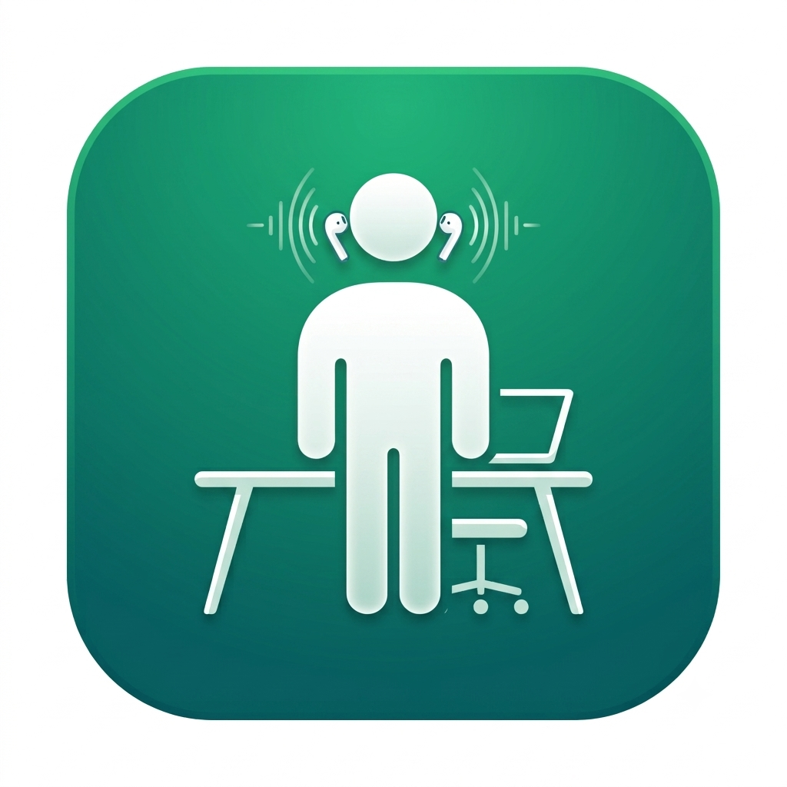

<div align="center">



# Upright

**Fix your posture while you work — using the motion sensors in your AirPods.**

[](https://www.apple.com/macos/)
[](https://swift.org)
[](LICENSE)

</div>

Upright sits in your menu bar, reads your AirPods' head-motion sensors, and
nudges you the moment your neck starts to slouch toward the screen.

## Install

Homebrew (downloads a prebuilt app — nothing to compile):

```bash
brew install --cask harshagv/tap/upright
```

Then launch **Upright** from Launchpad/Spotlight; it lives in the menu bar.

From source (requires macOS 14+ and the Xcode Command Line Tools —
`xcode-select --install`; a full Xcode install is not required):

```bash
git clone https://github.com/harshagv/healthbar.git
cd healthbar && make run
```

## First run

1. Connect your AirPods (Pro, 3rd gen, Max, or Beats Fit Pro).
2. Click the menu-bar icon → **Start monitoring**, then allow the Motion and
   Notification prompts.
3. Sit up straight, then click **Calibrate**.
4. Slouch and you'll get a nudge.

## Features

- Reads head pitch via Apple's Core Motion — no extra hardware.
- One-tap calibration of your upright posture baseline.
- Nudges via in-ear sound, an optional spoken cue, and a macOS notification.
- Live stats and a 7-day history chart.
- Tunable sensitivity, hold time, cooldown, and alert sound.
- Start at login. Fully local — nothing leaves your Mac.

## Settings

| Setting | Description |
| --- | --- |
| Sensitivity | How far your head must drop before it counts as slouching |
| Hold before alert | How long you must slouch before being nudged |
| Alert cooldown | Minimum gap between nudges |
| Alert sound | Pick the system sound (with preview) |
| Sound / Spoken / Notification | Toggle each cue on or off |
| Reverse detection | Flip if alerts fire when you sit up instead of slouch |
| Start at login | Launch Upright automatically |

## How it works

Modern AirPods expose a 9-axis IMU through `CMHeadphoneMotionManager` — the data
behind Spatial Audio head tracking. Upright streams your head pitch, captures
an upright posture baseline when you calibrate, filters the signal, and flags a slouch
when your head stays dropped past your threshold for a few seconds. There's no
API to buzz AirPods, so the nudge is an in-ear sound/voice cue.

## Compatibility

macOS 14+. AirPods Pro (1st/2nd gen), AirPods (3rd gen), AirPods Max, or
Beats Fit Pro.

## Releasing & publishing to Homebrew

Upright is distributed as a **Homebrew Cask** — a prebuilt `.app` that a GitHub
Actions workflow compiles and attaches to each release, so end users never need
Xcode or the Command Line Tools. Two GitHub repos are involved:

- **`harshagv/healthbar`** — this repo (app source, the release workflow at
  [`.github/workflows/release.yml`](.github/workflows/release.yml), and a
  reference copy of the cask in [`Casks/upright.rb`](Casks/upright.rb)).
  Pushing a `v*` tag builds **every app under `apps/`** and attaches a
  `<App>.zip` and a `<App>.dmg` for each to the one release, so
  [the releases page](https://github.com/harshagv/healthbar/releases) carries
  installable bundles for Upright and MiniMe alike. Tag a single app with
  `<app>-v<version>` (e.g. `minime-v0.1.0`) to release just that one.
- **`harshagv/homebrew-tap`** — the tap that actually serves the cask.
  `brew install --cask harshagv/tap/upright` expands to *"clone repo
  `harshagv/homebrew-tap`, install `Casks/upright.rb`"* — Homebrew reads that
  repo over the network, **not** the copy in this one.

### One-time tap setup

Create the tap repo and seed it with the cask:

```bash
gh repo create harshagv/homebrew-tap --public -d "Homebrew tap for Upright" --clone
cd homebrew-tap
mkdir -p Casks
cp ~/Documents/upright/Casks/upright.rb Casks/upright.rb
git add Casks/upright.rb && git commit -m "Add upright cask" && git push -u origin main
```

### Cutting a release

1. Bump the version in `apps/Upright/Resources/Info.plist` (`CFBundleShortVersionString` and
   `CFBundleVersion`), then commit and push `main`.
2. Tag and push — this fires the **Release** workflow, which builds
   `Upright.app`, zips it to `Upright.zip`, and **creates the GitHub release**
   with that asset attached (no separate `gh release create` needed):

   ```bash
   git tag v0.1.1 && git push origin v0.1.1
   ```

   Add release notes afterward with `gh release edit v0.1.1 --notes "…"`.

3. Wait for the **Release** workflow to finish uploading `Upright.zip`, then sync
   the cask. The helper script reads the version from `Info.plist`, downloads the
   release asset, computes its `sha256`, rewrites `Casks/upright.rb`, commits
   here, and pushes the tap — all in one command:

   ```bash
   chmod +x scripts/update-cask.sh                          # first time only
   TAP_DIR=~/Documents/homebrew-tap scripts/update-cask.sh
   ```

   (Run it without `TAP_DIR` to update only the local cask. Pass an explicit
   version as `scripts/update-cask.sh 0.1.1` to override `Info.plist`.)

4. Install or upgrade:

   ```bash
   brew install --cask harshagv/tap/upright      # first install
   brew upgrade --cask harshagv/tap/upright      # later releases
   ```

### Cleaning up a mistaken or duplicate release

If you've published a tag/release you want to redo (e.g. a stray `v0.1.2`),
delete it everywhere, then re-cut the version you want so the workflow rebuilds
the app from the current source:

```bash
# 1) remove the unwanted tag + its GitHub release (and uploaded assets)
git push origin :refs/tags/v0.1.2     # delete the remote tag
git tag -d v0.1.2                      # delete the local tag
gh release delete v0.1.2 --yes        # delete the GitHub release

# 2) re-cut the canonical version — pushing the tag rebuilds Upright.zip AND
#    recreates the release via the workflow (no gh release create needed)
git tag -d v0.1.1 2>/dev/null; git push origin :refs/tags/v0.1.1 2>/dev/null
gh release delete v0.1.1 --yes 2>/dev/null
git tag v0.1.1 && git push origin v0.1.1
```

Re-tagging triggers the **Release** workflow; when it finishes, sync the cask
with the helper script, then refresh your install. You can't `brew untap` a tap
that has an installed cask, so refresh in place instead:

```bash
TAP_DIR=~/Documents/homebrew-tap scripts/update-cask.sh   # recompute sha + push tap
brew update                                                # pull the tap's new cask
brew reinstall --cask harshagv/tap/upright                # force a clean reinstall
```

To validate the cask before publishing, run `brew audit --cask Casks/upright.rb`
and `brew install --cask Casks/upright.rb` from this repo once a release exists.

> The build is **ad-hoc signed** (no Apple Developer ID), so on first launch
> macOS Gatekeeper may warn the app is unverified. The cask's caveats show the
> one-time `xattr -dr com.apple.quarantine` fix. For a warning-free install,
> sign with a Developer ID and notarize in the workflow.

> Keep `Info.plist`'s version and the git tag in sync — the tag names the
> release the cask downloads, and the plist drives the version shown in-app.

## Contributing

PRs welcome — see [CONTRIBUTING.md](CONTRIBUTING.md).

## License

[MIT](LICENSE) © harshagv
